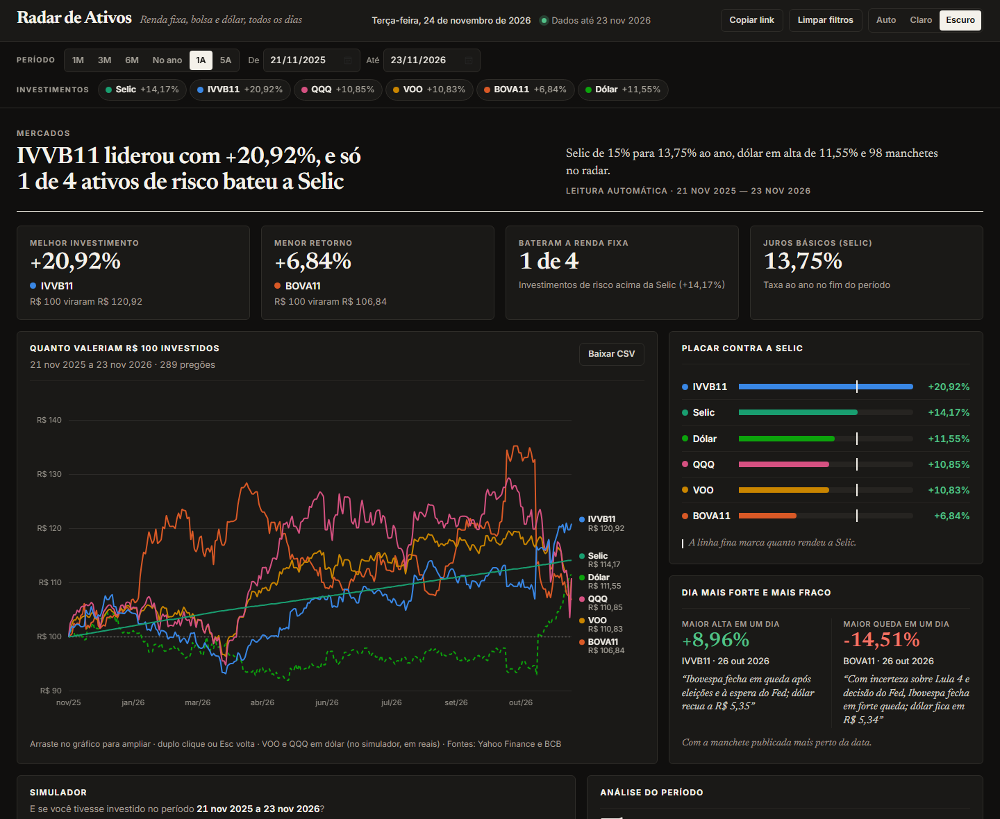
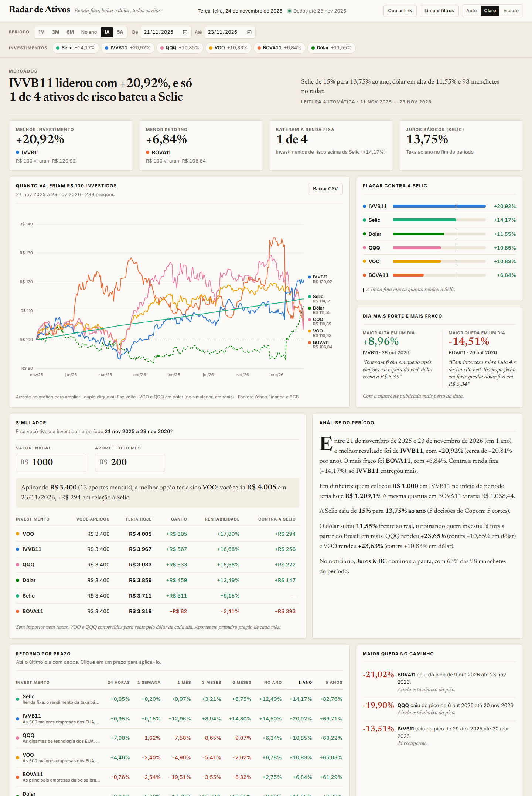

<div align="center">

# Radar de Ativos

**Painel operacional que compara, dia a dia, renda fixa (Selic), bolsa brasileira, ETFs americanos e dólar, e explica o período em português simples, cruzando os números com as notícias que moveram o mercado.**


[🔗 Abrir o painel](https://wrkcoronel.github.io/radar-de-ativos/) · [O que dá para fazer](#o-que-dá-para-fazer) · [Como funciona](#como-funciona) · [Rodando localmente](#rodando-localmente)

**Projeto pessoal · Dados e automação**



</div>

---

## O que é o projeto

O Radar de Ativos responde a uma pergunta comum de quem investe: *nesse período, onde o dinheiro teria rendido mais, na renda fixa, na bolsa brasileira, na bolsa americana ou no dólar?* Ele põe todas as opções no mesmo gráfico, começando de R$ 100, e escreve em português simples quem ganhou, por quê e quais notícias mexeram com o mercado naquele momento.

Funciona direto no navegador, sem cadastro e sem instalar nada. A pessoa escolhe o período e os investimentos, e a página recalcula tudo na hora, inclusive um simulador de "e se eu tivesse investido R$ X?". A **Selic** é a taxa básica de juros do país, a referência da renda fixa.

**O que o projeto mostra, para quem avalia o trabalho:**

- **Pipeline de dados completo:** coleta de fontes públicas (Yahoo Finance, Banco Central e Google News), alinhamento das séries e consolidação em uma base única.
- **Análise automática:** os textos, indicadores e a nota de cada notícia são gerados a partir dos números, para qualquer período escolhido.
- **Custo zero para manter:** site estático no GitHub Pages e extrator em Node.js sem dependências externas.
- **Qualidade e automação:** testes automatizados e atualização dos dados por GitHub Actions.
- **Atenção a detalhes que mudam o resultado:** correção das datas do câmbio e cores pensadas para quem tem daltonismo.

---

## O que dá para fazer

| | |
| --- | --- |
| **Filtrar o período** | Atalhos (1M, 3M, 6M, no ano, 1A, 5A), datas livres "De/Até" ou arrastando direto no gráfico. Tudo na página se recalcula. |
| **Ligar e desligar investimentos** | Selic, IVVB11, BOVA11, VOO, QQQ e dólar. Gráfico, indicadores, análise, simulador e notícias seguem o filtro. VOO e QQQ aparecem em reais por padrão, com opção de ver em dólar. |
| **Simular** | "E se eu tivesse investido R$ X, com aporte de R$ Y por mês?" Mostra quanto teria hoje em cada opção e a diferença contra a Selic, sempre em reais. |
| **Ler a análise automática** | Manchete, texto e quadros gerados na hora: quem bateu a renda fixa, trajetória da Selic (decisões do Copom), efeito do câmbio, maior queda no caminho (e quem ainda está no vermelho hoje) e o dia mais forte e o mais fraco, com a manchete do mesmo dia ou de um dia vizinho. |
| **Pesquisar notícias** | Busca por palavra (sem diferença de acento), filtro por tema e ordenação por relevância ou data. |
| **Compartilhar e exportar** | Os filtros ficam no link (*Copiar link*) e no navegador; o período pode ser baixado em CSV pronto para o Excel em português. |



---

## Como funciona

```
 Yahoo Finance ─┐
 Banco Central ─┼─► Extrator Node.js ─► dados/*.json ─► Página estática ─► análise no navegador
 Google News  ──┘   (sem dependências)   (consolidado)     (GitHub Pages)    (filtros, simulador, texto)
```

1. **Coleta** (`backend/`), local ou pelo botão *Run workflow* no GitHub Actions: baixa 5 anos de preços diários (Yahoo Finance), a Selic diária oficial (BCB, série SGS 11) e manchetes históricas mês a mês (Google News RSS), com novas tentativas em caso de falha.
2. **Consolidação**: alinha as séries nos dias de pregão (*forward-fill*), coloca tudo na mesma base (R$ 100 no início) e dá a cada notícia uma nota de 0 a 100.
3. **Análise no navegador** (`frontend/`): manchete, textos, indicadores, simulações e filtros são calculados na hora para qualquer recorte, sem servidor e sem custo por visitante.

### Como a nota das notícias é calculada

| Critério | Peso | Como |
| --- | :---: | --- |
| Impacto real no preço (±1 dia) | até 50 | Cruza a data da notícia com a variação diária dos ativos; mudança da Selic na janela vale +18 para notícias de juros. |
| Relevância do tema | até 25 | Juros & BC > Macro & Inflação > Mercado & Tech > Mercado geral > Economia. |
| Autoridade da fonte | até 15 | Veículos financeiros consolidados valem mais. |

Depois disso: filtro de ruído, remoção de manchetes quase iguais e no máximo 8 notícias por mês.

---

## Decisões técnicas

- **Site 100% estático.** Os dados somam ~2,6 MB e não há escrita do usuário, então não há necessidade de backend nem banco. Hospedagem gratuita e nada para manter.
- **Extrator sem dependências.** Só `fetch` e `node:fs` nativos do Node; nada para atualizar nem auditar.
- **Decisões do Copom reconstruídas da taxa diária.** A série SGS 11 é a Selic *efetiva* diária. Ela é anualizada (252 dias úteis), recebe +0,10 p.p. (a diferença média para a meta) e é arredondada para passos de 0,25. Uma nova meta só conta após 3 pregões seguidos, o que filtra ruído de arredondamento. O resultado bate com o histórico real (ex.: 9,25% em dez/21, pico de 15% em jun/25).
- **Reais por padrão.** VOO e QQQ são cotados em dólar, mas quem investe do Brasil aplica e resgata em reais; por isso o gráfico, o placar e o simulador convertem pelo câmbio do dia, e o botão "VOO e QQQ em" mostra a versão em dólar.
- **Datas do câmbio corrigidas.** O Yahoo grava o BRL=X como uma foto da meia-noite de Londres, e a data UTC dessa foto fica um dia atrasada no inverno. O consolidador corrige isso (e trata fim de semana como fechamento da sexta); a correlação diária entre o IVVB11 e o VOO convertido subiu de 0,42 para 0,88. O calendário usa só dias de pregão.
- **Filtros que envelhecem bem.** Atalhos como "6M" são salvos como período relativo (amanhã continuam sendo "os últimos 6 meses"); datas digitadas ficam fixas.
- **Cores validadas.** A paleta dos ativos passou por um validador de daltonismo e contraste, com uma versão para cada tema; as linhas têm rótulo direto e o dólar é tracejado, para a identificação não depender só da cor.
- **Segurança.** Títulos e links vindos do RSS são escapados antes de ir para a página, e links `javascript:` são bloqueados.

---

## Rodando localmente

Requisitos: Node.js 18+.

```bash
npm run extrair     # baixa preços e Selic e gera dados/consolidado_*.json
npm run noticias    # baixa e pontua as notícias (mais demorado)
npm test            # roda os testes (node:test)

npx serve .         # sobe a pasta e abra http://localhost:3000/frontend/
```

A página precisa ser servida por HTTP (abrir o `index.html` direto do disco bloqueia o carregamento dos JSON).

## Estrutura

```
backend/
  services/     yahoo, selic (BCB) e notícias (Google News RSS + nota)
  domain/       consolidação das séries
frontend/
  js/components/
    chart.js      gráfico (Chart.js) com rótulos diretos, recorte por arraste e escala em R$
    summary.js    análise automática: Copom, queda máxima, câmbio, manchete e textos
    simulator.js  simulador de aporte inicial + mensal, com conversão cambial
    newsPanel.js  notícias: filtro, busca, ordenação
    estado.js     filtros no link e no navegador
    exportar.js   CSV no padrão do Excel em português
dados/          JSON consolidados que a página consome
tests/          testes de consolidação, notícias, análise e simulador
```

## Limitações conhecidas

- O Yahoo Finance não tem API oficial; o endpoint usado pode mudar ou limitar acessos.
- O simulador não considera impostos, taxas nem dividendos reinvestidos além do que já está no preço.
- O dólar do último pregão pode ser o fechamento do dia anterior (a cotação de Londres só fecha à meia-noite).
- O recorte de 5 anos começa com a Selic em 7,75% e em alta, o que favorece a renda fixa; em outros períodos o placar muda.

## Próximos passos

- [x] Atualização por GitHub Actions sob demanda (testar → extrair → publicar só se os dados mudarem).
- [ ] Atualização diária sem commitar os dados (publicar direto no Pages), para não inflar o histórico.
- [ ] Mover dados para Cloudflare Workers + D1 e servir por API.
- [ ] Carteiras salvas e alertas por usuário.

---

Projeto educacional. Rentabilidade passada não garante resultado futuro, e nada aqui é recomendação de investimento.
